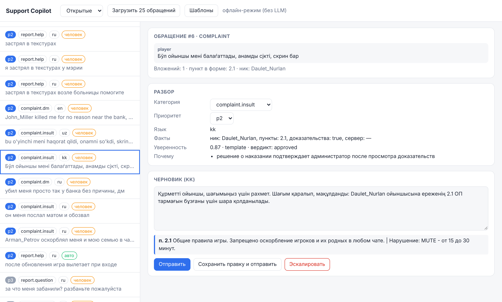

# Support Copilot

[](https://github.com/alirahmadi/grand_mobile_support_copilot/actions/workflows/tests.yml)

Триаж обращений игроков Grand Mobile (Decentrathon 6.0, кейс 03): язык, категория, приоритет, дубли и спам,
извлечение фактов, черновик ответа на языке игрока с цитатами правил и флаг «нужен человек».



## Подход

- Нормализация текста: казахские буквы из cp1251-замен (ќ→қ, ѓ→ғ, ѕ→ң, є→ә, ј→ө, ў→ұ, ї→ү), латиница внутри кириллицы, транслит.
- Категория и приоритет: словари по шести языкам и классификатор, обученный на train. Угрозы и взломы повышают приоритет.
- Ссылки на правила с кодом документа, как в таксономии: `2.1` (общие), `GZ 1.2`, `ЖБ 1.2.7`. Поле «пункт правил»
  разбирается в любом написании: «2.1оп», «1.1 gz», «оск», «опру».
- Решение по жалобе (одобрить, нужны доказательства, не по форме, дубль, апелляция…) предсказывает модель,
  обученная на 43 тыс. реальных вердиктов администраторов.
- RAG: BM25 по `rules.json` и поиск похожих решённых обращений с ответами администраторов (114 тыс.).
- Черновик: Claude Haiku 5.5 со структурированным выводом, если задан ключ, иначе шаблоны на ru/kk/uz/en.
  Если LLM не ответил за 3.5 с, используется шаблон.
- Проверка ответа: цитируются только существующие и относящиеся к делу пункты. Разбан, возврат средств,
  наказание игрока, платежи, апелляции и взлом аккаунта всегда получают `needs_human: true`.
- Дубли: тот же игрок, похожий текст или та же тема в течение 60 минут.

## Запуск

```bash
pip install -r requirements.txt
```

Файлы организаторов кладутся в `data/` (папка исключена из git).

```bash
make train                                   # база знаний, наказания по пунктам, модели
make eval                                    # метрики на валидации -> reports/
make predict IN=tickets.jsonl OUT=pred.jsonl
make serve                                   # POST /triage и админка на http://localhost:8000
```

Без `make` (Windows): `python -m copilot.cli train`, `eval`, `predict --in tickets.jsonl --out pred.jsonl`, `serve`.

Ключ Claude задаётся в `.env` (пример в `.env.example`). Без ключа сервис работает офлайн.
`make label` размечает часть train через LLM для дообучения классификатора.

## Скрытый тест

```bash
make predict IN=tickets_hidden.jsonl OUT=pred.jsonl
```

Если моделей ещё нет, `make predict` сначала сам запустит `make train` (нужны файлы организаторов в `data/`, около 3 минут).
На выходе одна строка JSON на каждое обращение в том же порядке: `ticket_id` + поля контракта. Рядом пишется
`pred.jsonl.stats.json` (доля «нужен человек», латентность, стоимость). Битые строки и нестандартные поля
не прерывают прогон: такое обращение получает безопасный ответ с `needs_human: true`.

## API

```bash
curl -X POST localhost:8000/triage -H "Content-Type: application/json" \
  -d '{"kind":"complaint","messages":[{"role":"player","text":"Arman_Petrov оскорблял меня в чате, скрины есть, 2.1","attachments":2}]}'
```

Ответ содержит поля из контракта и служебный блок `meta` (режим, вердикт, стоимость, латентность).
`predict --no-meta` выводит только поля контракта.

## Результаты на валидации

1000 обращений из `tickets_valid.jsonl`, офлайн-режим (без LLM). Подробный отчёт с матрицей решений,
расчётом стоимости LLM-режима, соответствием критериям ТЗ и примерами черновиков: [docs/REPORT.md](docs/REPORT.md).

| Метрика | Значение |
|---|---|
| Совпадение предложенного решения по жалобе с решением администратора (518 жалоб) | 59.7% (если всегда «одобрено» — 34.2%) |
| Цитаты, существующие в `rules.json` | 100% |
| Цитируемый пункт совпадает с пунктом, который указал администратор | 71% |
| Автоответы на жалобы, совпадающие с решением администратора | 86% |
| Доля «нужен человек» | 89% |
| Латентность p50 / p95 | 84 / 146 мс |
| Стоимость | $0 офлайн, около $0.0004 за обращение с Claude Haiku 5.5 (расчёт) |

## Структура

```
copilot/    пайплайн, классификация, RAG, шаблоны, LLM, сервер, обучение и оценка
samples/    демо-данные для тестов (не данные Grand Mobile)
tests/      pytest
```

## Зависимости

scikit-learn, FastAPI, Uvicorn, NumPy, Anthropic Python SDK, Claude API. Данные Grand Mobile в репозиторий не входят.

## Команда P-здесь

- Абдуларон — тимлид, продакт: требования кейса, отчёт, презентация
- Рахымжан — LLM/ML-инженер: RAG, классификация, оценка качества
- Алихан — бэкенд-разработчик: API `/triage`, `make predict`, админка
- Мәди — QA и языки: черновики на казахском и узбекском, тесты

Спасибо за помощь: Рамазан, Алмат.
